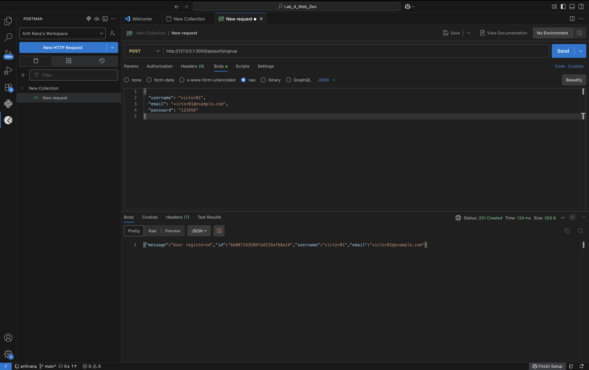
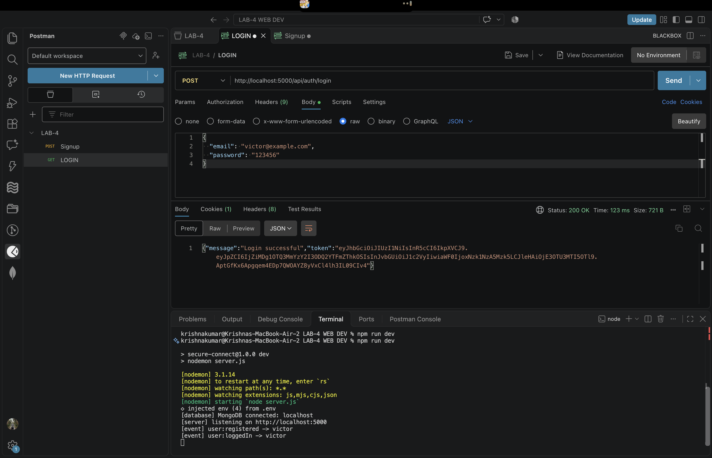
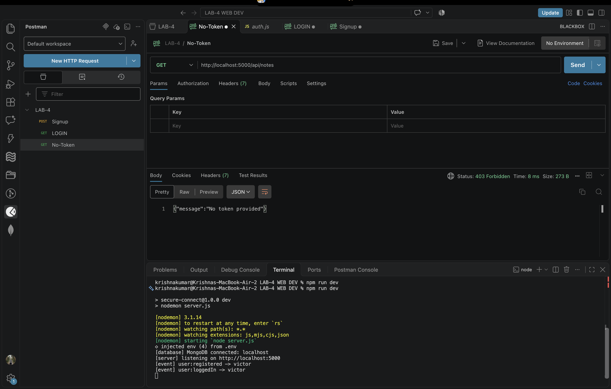
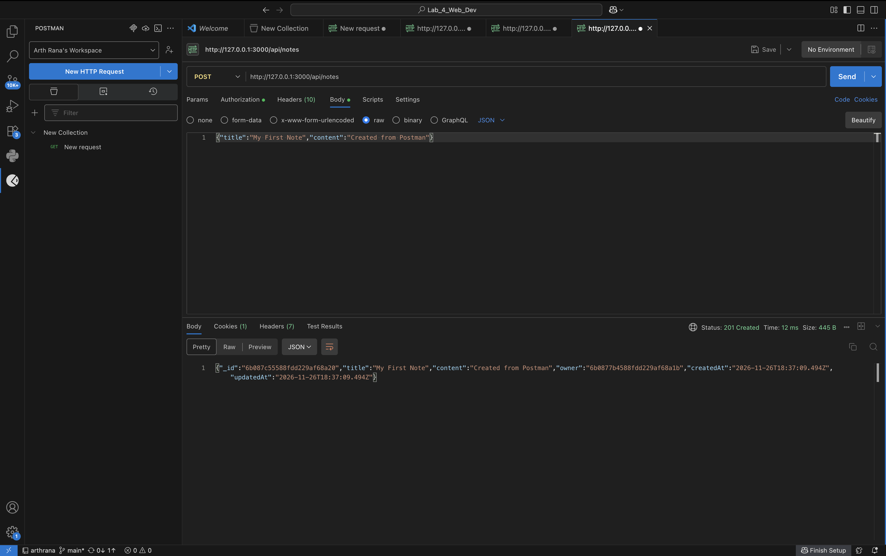
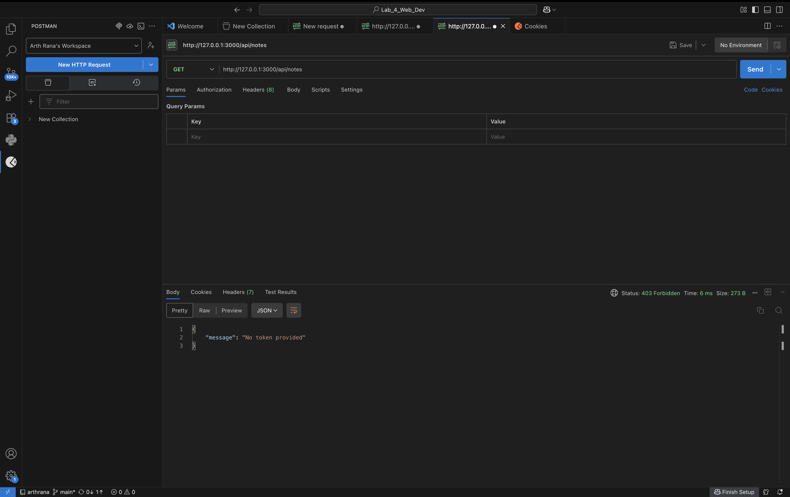
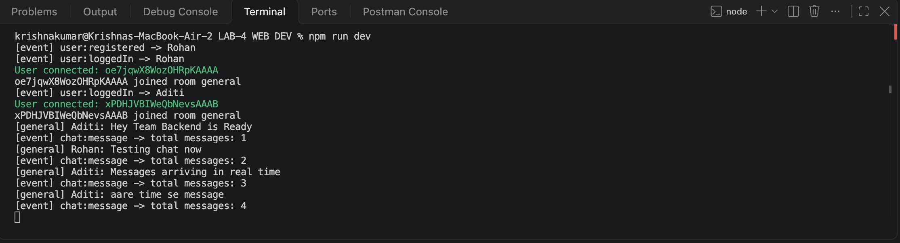

## Output Screenshots

### 1. Signup (201 Created)

### 2. Login (200 OK, JWT token)

### 3. Notes API without token (403 Forbidden)

### 4. Create Note with token (201 Created)

### 5. Get all notes (200 OK)

### 6. Real-time chat (Socket.IO console)

